<!-- HEADER BANNER -->

  
  

  

  

---
# 👨‍💻 About Me

## vinh-gogo

**AI Engineer**
**Specialization in LLM Applications & Multi-Agent Systems**

**Creator of GloryVocab • Vietnam (UTC+7)**

  

---

I enjoy building intelligent, production-ready AI systems—from multi-agent orchestration and Retrieval-Augmented Generation (RAG) pipelines to LLM tooling, backend APIs, and scalable web applications.

- 🤖 **Role / Field:** AI Engineer (LLM Applications, Multi-Agent Systems & RAG)
- 🏆 **Flagship Work:** Creator of **[GloryVocab](https://gloryvocab.com)** — an AI-powered vocabulary and smart language learning platform
- 🎯 **Focus Areas:** Multi-Agent Workflows, Hybrid RAG, Model Context Protocol (MCP) & AI Observability
- 📬 **Contact:** lea26462@gmail.com
- 🌐 **Website:** <a href="https://gloryvocab.com" target="_blank">gloryvocab.com</a>

<!-- SOCIAL / PROFILE BADGES -->

---

  <h2 style="font-size: 28px !important; font-weight: bold; margin: 0 0 5px 0; line-height: 1.5;">
    🌐 Socials:
  </h2>
  

  
  
  
  
  

---
## 🚀 Featured Projects

<table>
  <tr>
    <td width="50%" valign="top">
      <h3>🌟 Project 1: GloryVocab — AI-Powered Language &amp; Vocabulary Platform</h3>
      
A production platform (<a href="https://gloryvocab.com" target="_blank">gloryvocab.com</a>) designed to accelerate vocabulary mastery through intelligent spaced repetition, contextual AI examples, and fast edge delivery paired with short-form educational content on TikTok.

      

        
        
        
        
      

    </td>
    <td width="50%" valign="top">
      <h3>🤖 Project 2: Multi-Agent &amp; RAG Orchestration Engine</h3>
      
An end-to-end agentic AI architecture combining stateful LangGraph workflows, hybrid vector + keyword retrieval, MCP tool integrations, and automated evaluation &amp; tracing pipelines built for high reliability and low latency.

      

        
        
        
        
      

    </td>
  </tr>
</table>

---

## Tech Stack

**Languages**

  
  
  
  

**AI / LLM & Frameworks**

  
  
  
  

**Infrastructure & Tools**

  
  
  
  

---

## GitHub Stats

<!-- Row 1: Animated AI Engineer GitHub Card -->
<table border="0" cellspacing="0" cellpadding="5">
  <tr>
    <td align="center" width="100%">
      
    </td>
  </tr>
</table>

---

## 💻 Spent My Time

  

---

  
<!-- ─────────────── DASHBOARD COUNTERS ─────────────── -->

  
<!-- ─────────────── QUICK NAVIGATION BUTTONS ─────────────── -->

 

---

### 🌟 Continuous Learning • Production Systems • Open Collaboration

---

## Currently Exploring

* 🧠 Large Language Models (LLMs) & Structured Outputs
* 🤖 Multi-Agent Systems & Stateful Orchestration (LangGraph)
* 🔍 Hybrid Retrieval-Augmented Generation (RAG) & GraphRAG
* 🔌 Model Context Protocol (MCP) & Autonomous Tool Use
* 📊 LLM Evaluation, Guardrails & AI Observability
* ⚡ High-Performance Python & TypeScript Backends
* 🌱 AI-Native Education Workflows at GloryVocab

---

<h2 align="center">⭐ Submit Your Rating &amp; Feedback</h2>

  Enjoyed my work? Pick a star rating below. The form opens with your rating already selected, 
  and your message goes straight to my inbox.

<table>
  <tr>
    <th align="center">Rating</th>
    <th align="center">Click to rate</th>
  </tr>
  <tr>
    <td align="center">⭐⭐⭐⭐⭐</td>
    <td align="center"></td>
  </tr>
  <tr>
    <td align="center">⭐⭐⭐⭐</td>
    <td align="center"></td>
  </tr>
  <tr>
    <td align="center">⭐⭐⭐</td>
    <td align="center"></td>
  </tr>
  <tr>
    <td align="center">⭐⭐</td>
    <td align="center"></td>
  </tr>
  <tr>
    <td align="center">⭐</td>
    <td align="center"></td>
  </tr>
</table>

 

  
  

---

  

---
# ⭐ Support

**If you find my repositories useful for building AI & LLM systems, consider giving them a ⭐.**

Your feedback, suggestions, and contributions are always welcome.

  <b>🧠 Architect LLMs • 🤖 Orchestrate Agents • 🔍 Build RAG • 🚀 Ship AI Products</b>

  Made with ❤️ for engineering, experimentation, and continuous improvement.

---

## What I'm Looking For

I'm actively looking for **AI Engineering**, **LLM Application**, **Multi-Agent Systems**, and **RAG Backend Architecture** opportunities and collaborations where I can contribute to production-scale AI systems and build impactful products.

**If you'd like to collaborate, discuss an opportunity, or just connect, feel free to reach out.**

---

  

---
---

### Thanks for visiting my profile!

**If you like my work, consider giving a ⭐ to the repositories you find useful.**

 

<svg fill="none" width="800" height="90" viewBox="0 0 800 90" xmlns="http://www.w3.org/2000/svg">
  <defs>
    <linearGradient id="footer-grad" x1="0%" y1="0%" x2="100%" y2="0%">
      <stop offset="0%" stop-color="#4a8be2" />
      <stop offset="50%" stop-color="#55759e" />
      <stop offset="100%" stop-color="#424c57" />
    </linearGradient>
  </defs>
  <path d="M0 40 Q 200 10, 400 35 T 800 25 L 800 90 L 0 90 Z" fill="url(#footer-grad)" opacity="0.6"/>
  <path d="M0 55 Q 250 25, 500 45 T 800 35 L 800 90 L 0 90 Z" fill="url(#footer-grad)"/>
</svg>

  

