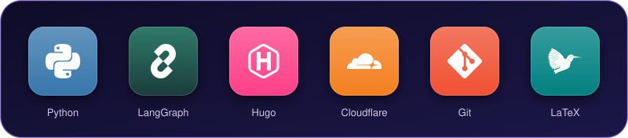

## Hello

I am an AI engineer. I build LLM and Multi-Agent systems, from the first idea to a working demo in front of clients.

My latest project is an Agentic real estate advisor system built with LangGraph. I showed it to the client in a live demo, and we signed a contract with UNITE to deploy it.

In my free time, I run a TOEIC practice website for the TikTok channel **@glory01**.

<!-- Add the YouTube demo link and the report of the Multi-Agent project to the text above if you want to make them public. -->

## Tech Stack

<!-- The icons above are drawn in tech-stack.svg (app-icon style). To add another technology, ask for it to be added to that file. -->

## GitHub Stats

<!-- hide=jupyter%20notebook: removes .ipynb files (used only for research) from the language stats -->

## Contact

<!-- Replace YOUR-LINKEDIN-ID with your own LinkedIn ID, or delete the line you do not use. -->

