## Hello

I am an AI engineer. I build LLM and Multi-Agent systems, from the first idea to a working demo in front of clients.

My latest project is an Agentic real estate advisor system built with LangGraph. I showed it to the client in a live demo, and we signed a contract with UNITE to deploy it. ([Demo video](https://youtu.be/fmhQLR4_IHE) · [Report](https://glory-hinody.pages.dev/posts/multi-agent-workflow-langraph/))

In my free time, I run a TOEIC practice website for the TikTok channel **@glory01**: [gloryvocab.com](https://gloryvocab.com).

## Tech Stack

<!-- Icons come from Simple Icons (https://simpleicons.org). Plain icons, no background. Format: https://cdn.simpleicons.org/<slug>/<optional hex color> -->

**LLM, RAG and Agents** 
&nbsp;&nbsp;&nbsp;
&nbsp;&nbsp;&nbsp;
&nbsp;&nbsp;&nbsp;
&nbsp;&nbsp;&nbsp;

**Backend and DevOps** 
&nbsp;&nbsp;&nbsp;
&nbsp;&nbsp;&nbsp;
&nbsp;&nbsp;&nbsp;
&nbsp;&nbsp;&nbsp;
&nbsp;&nbsp;&nbsp;

**Web and Edge** 
&nbsp;&nbsp;&nbsp;
&nbsp;&nbsp;&nbsp;
&nbsp;&nbsp;&nbsp;
&nbsp;&nbsp;&nbsp;

**Mobile and Desktop** 
&nbsp;&nbsp;&nbsp;
&nbsp;&nbsp;&nbsp;

**Docs** 

## What I Build

### Multi-Agent Customer Support and Real Estate Advisor

Demoed to real clients and signed a contract with UNITE Co. [Demo](https://youtu.be/fmhQLR4_IHE) · [Report](https://glory-hinody.pages.dev/posts/multi-agent-workflow-langraph/)

- **LangGraph** multi-agent workflow with a **Semantic Router**: it detects the user's intent, then hands off to the right agent (check menu, check stock, create bill, real estate consulting).
- **Hybrid Search** (semantic + **BM25**) reaches **95% Hit@1** and **99% Hit@5** on 3,200 labeled queries from real chat logs.
- Data pipeline that turns raw Excel (`.xlsx`) files into clean text, images and structured data for the agents.

### pdf-rag: Water and ESG Report Search

Built at WETEC. [GitHub](https://github.com/Vinh-Gogo/pdf-rag)

- **Vision-OCR** (**Qwen2-VL**) plus **LLM post-processing** (**Qwen3**) to check words: **99.7% text accuracy** on 168 pages with multi-column text and tables.
- **Hybrid RAG** (**Qdrant** + **BM25**): search by paragraph, return the full page. **80% Hit@10**, +24% MRR.
- **FastAPI Streaming** + **Next.js** UI with PDF upload and page citations, packed with **Docker**, running local models so company data stays private.

### Glory Vocab: Multilingual TOEIC Vocabulary Platform

[gloryvocab.com](https://gloryvocab.com) · [GitHub](https://github.com/Vinh-Gogo/GLORY-TIKTOK) · **29,450 requests/week** from 35+ countries · **$0/month** server cost

- **Offline-first**: guests learn fully offline with **IndexedDB** and a **Service Worker**; **Cloudflare Pages Functions + D1** at the edge for optional Google sync.
- **FSRS** spaced repetition with a **commutative merge**, so devices can sync in any order. The browser and the edge run the same merge logic, checked by shared test fixtures.
- **Static site at scale**: **Hugo** + PaperMod generates thousands of SEO pages in 3 languages (Vietnamese, English, Japanese), with a file budget that stays under the Cloudflare Pages limit.
- **WAF + rate limiting** to block scrapers, and **privacy first**: no telemetry, no tracking scripts, no IP logging.
- **Vanilla JS and CSS design tokens**: no framework, dark and light themes, mobile-first.
- **Quality gates**: Python validators, Node test runner (416 tests), performance budgets, and **GitHub Actions** CI/CD to Cloudflare Pages. User bug reports are turned into GitHub Issues automatically.
- **AI-agent workflow** (`AGENTS.md`): an Orchestrator that only plans and reviews, plus specialist subagents (data, frontend, edge backend, i18n, performance, security, QA, release) with strict file ownership and evidence-based handoffs.

### AI Lingua: Cross-Platform Language Learning App

[GitHub](https://github.com/Vinh-Gogo/ai-english) · [Demo](https://vt.tiktok.com/ZSbkSYhjv/) · [Report](https://glory-hinody.pages.dev/posts/on-device-ai-onnx-kotlin/)

- **Kotlin Multiplatform** + **Compose Multiplatform** (one codebase for Desktop and Mobile), **MVI**, Clean Architecture, **SQLDelight**.
- **On-device Vietnamese handwriting recognizer** using pure geometry rules (32-point normalization, 3x3 density vector): runs offline in under 0.5 ms on CPU, no model needed.
- **Gemini API + Novita AI** for exercise generation, with auto-switching when the quota runs out.
- **FSRS** flashcards, and **GitHub Actions** that build installers for Windows, macOS, Linux and Android.

### Monocular Depth Estimation Using CNNs

Published at the SSRC Conference. [Paper](https://ssrc.fit.iuh.edu.vn/conf/article/view/43) · [GitHub](https://github.com/Vinh-Gogo/depth-estimation) · [Report](https://glory-hinody.pages.dev/posts/depth-estimation-cnn-ssrc/)

- Hybrid **U-Net with ResNet-DenseNet** encoder (7.51M parameters) trained on the **LineMOD** RGB-D dataset.
- **0.037 RMSE** on 1,200 test images (U-Net 0.038, CAE 0.041), and 3D **Point Clouds** rebuilt from the predicted depth maps.

### Also exploring

Generative AI and Vision: Diffusion Transformers, LoRA, int8/fp4 quantization, RIFE frame interpolation, ComfyUI, and serving LLMs with vLLM.

## GitHub Stats

<!-- hide=jupyter%20notebook: removes .ipynb files (used only for research) from the language stats -->

## Contact

