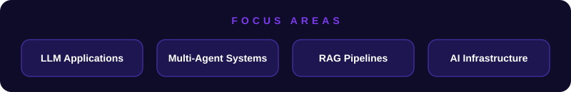
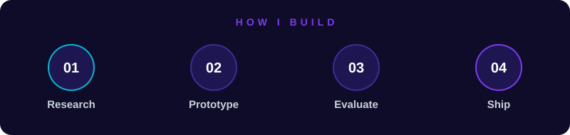
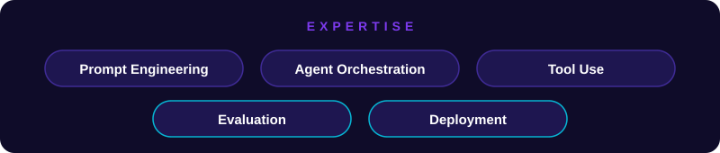

 

  

---

## 👨‍💻 About Me

  

I am an **AI Engineer** focused on building **LLM applications** and **Multi-Agent systems**: from prompt and retrieval design to agent orchestration and production-ready services.

- 🎯 **Focus areas:** LLM Applications, Multi-Agent Systems, Retrieval-Augmented Generation (RAG)
- 🌱 **Side project:** a TOEIC practice platform for the TikTok channel **@glory.vocabulary**
- 📬 **Contact:** [lea26462@gmail.com](mailto:lea26462@gmail.com)

  

---

## 🚀 Featured Project

<table>
  <tr>
    <td width="100%" valign="top">
      <h3>📚 GloryVocab: TOEIC Practice Platform</h3>
      

        A web platform that helps learners practice TOEIC vocabulary and exam questions.
        It is built and maintained alongside the TikTok channel
        <b>@glory.vocabulary</b>, turning short-form learning content into hands-on practice.
      

      

        
        
      

    </td>
  </tr>
</table>

> 💡 *More featured projects (LLM / Multi-Agent) will be pinned on this profile as they are published.*

---

## 🛠️ Tech Stack

**Languages**

  
  
  

**AI / LLM**

  
  
  

**Backend & Infrastructure**

  
  
  

---

## 📊 GitHub Stats

  
  

---

## ⚙️ How I Build

  

---

## 🔭 Currently Exploring

| | |
|---|---|
| 🧠 Large Language Models (LLMs) | 🤖 Multi-Agent Orchestration |
| 🔍 Retrieval-Augmented Generation (RAG) | 🧰 Tool Use & Function Calling |
| 📈 LLM Evaluation & Observability | ⚡ AI Infrastructure & MLOps |

---

## 🤝 What I'm Looking For

I'm open to **AI / LLM Engineering** opportunities and collaborations on **Multi-Agent systems** and real-world AI products. If you'd like to work together or just connect, feel free to reach out.

---

## 🌐 Contact

  

  
  
  
  

---

  

### Thanks for visiting my profile! ⭐

*If you find my work useful, consider giving a star to the repositories you like.*

