<!-- LÊ QUANG VINH (@vinh-gogo) — GLORY HINODY // ROYAL SAPPHIRE & 24K LIQUID GOLD EDITION -->

  

  &nbsp;&nbsp;&nbsp;&nbsp;

  

  

https://github.com/user-attachments/assets/6877cc8f-0cb6-40ca-b84d-8a812f492ae5

  

  &nbsp;

  &nbsp;

  

  

