<!-- HERO & ARCHITECTURE BANNERS -->

  
  
  

  

  

---

## 👨‍💻 About — Lê Quang Vinh (`vinh-gogo`)

<table>
  <tr>
    <td width="110" align="center" valign="middle">
      
    </td>
    <td valign="middle">
      <b>AI R&amp;D Engineer</b> — bridging academic depth and product discipline to build deterministic, verifiable AI systems. 
      <b>Core Focus:</b> Generative AI • Video Diffusion • Hybrid GraphRAG • Deterministic Saga Agents • On-Device &amp; Offline-First AI
    </td>
  </tr>
</table>

  

  
  
  
  
  

---

## 🚀 Flagship Systems & Technical Monographs

<table>
  <tr>
    <td width="50%" valign="top">
      <h3>📚 <a href="https://github.com/vinh-gogo/gloryvocab" target="_blank">Glory Vocab</a> — Edge Dictionary &amp; FSRS</h3>
      
Offline-first TOEIC &amp; workplace platform (<a href="https://gloryvocab.com" target="_blank">gloryvocab.com</a>) scaling <b>8,400 static Hugo pages</b>, 6,000+ curated words, <b>FSRS</b> spaced-repetition scheduling, and <b>Cloudflare D1</b> synchronization.

      

        
        
        
      

    </td>
    <td width="50%" valign="top">
      <h3>✍️ AI-Doodle CLI — Deterministic Go Engine</h3>
      
Multi-mode creative &amp; publishing engine built in <b>Go</b>, orchestrating reliable multi-step generation via <b>Saga state machines</b> and standard <b>W3C EPUB 3.3</b> output.

      

        
        
        
      

    </td>
  </tr>
  <tr>
    <td width="50%" valign="top">
      <h3>🎙️ Claw-CLI — Vietnamese Voice Terminal</h3>
      
Low-latency Vietnamese voice-controlled terminal assistant combining on-device <b>Silero VAD v5 ONNX</b> inference with a deterministic <b>4-tier safety sandbox</b>.

      

        
        
        
      

    </td>
    <td width="50%" valign="top">
      <h3>🎬 Video Factory (Doodle Explainer)</h3>
      
Production animation pipeline structured into <b>6 deterministic stages</b> with <b>Content-Addressed Caching</b> for reproducible Generative AI &amp; Video Diffusion rendering.

      

        
        
        
      

    </td>
  </tr>
</table>

---

## 🛠️ Tech Stack

  
  
  
  
  
  
  
  
  

---

## 📊 Engineering Telemetry

  

  

---

## 📖 Technical Logbook (`glory-hinody.pages.dev`)

  
  
    
  
  
  
  

---

<h2 align="center">⭐ Feedback &amp; Collaboration</h2>

  <table>
    <tr>
      <th align="center">Rating</th>
      <th align="center">Submit</th>
    </tr>
    <tr>
      <td align="center">⭐⭐⭐⭐⭐</td>
      <td align="center"></td>
    </tr>
    <tr>
      <td align="center">⭐⭐⭐⭐</td>
      <td align="center"></td>
    </tr>
    <tr>
      <td align="center">⭐⭐⭐</td>
      <td align="center"></td>
    </tr>
  </table>
   
  

---

  

  

